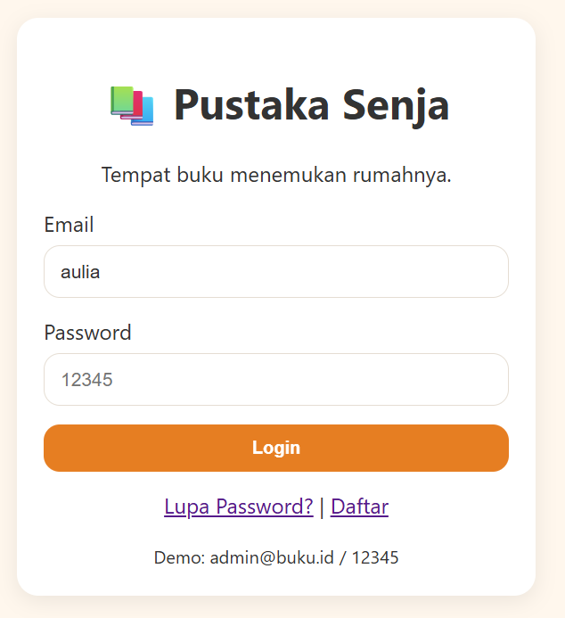
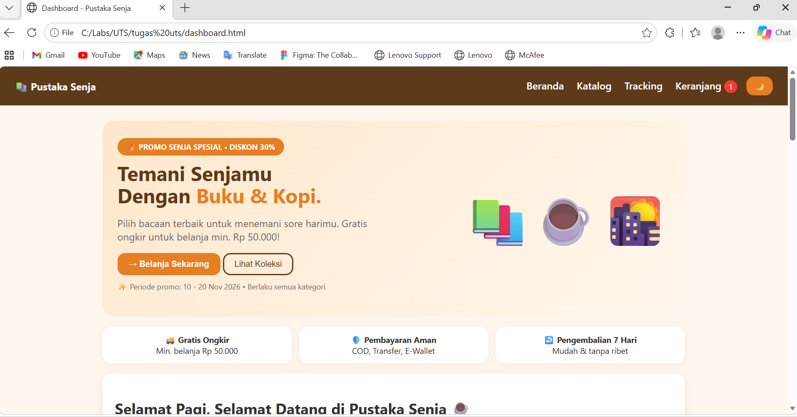
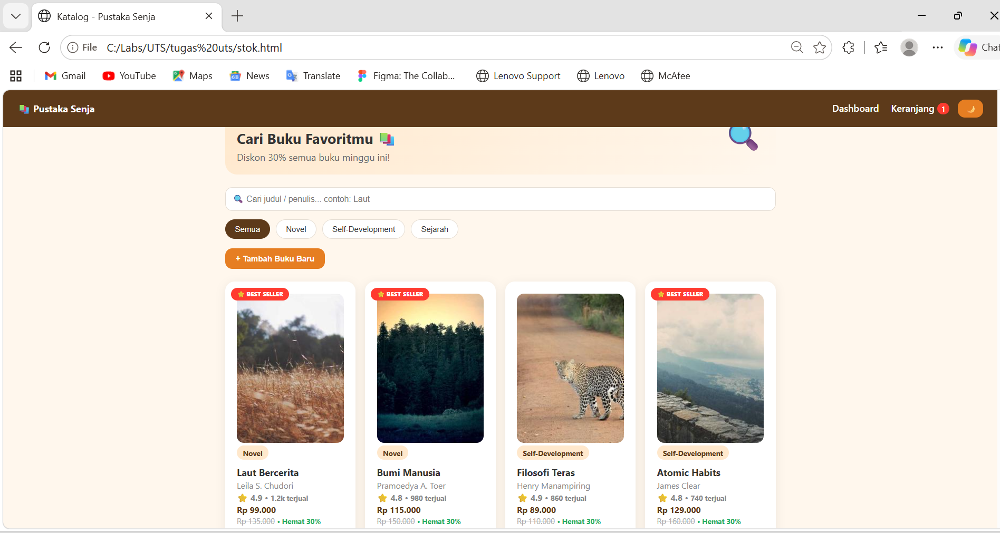
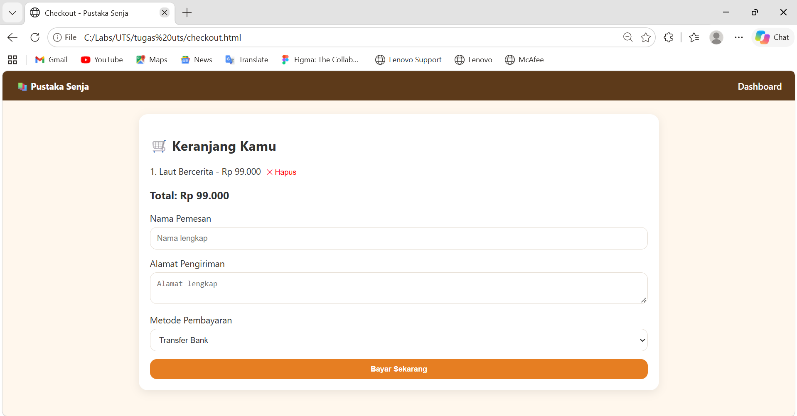
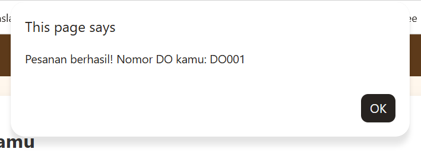
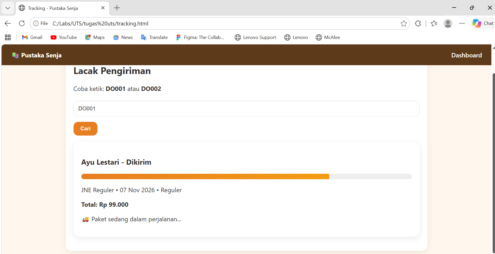
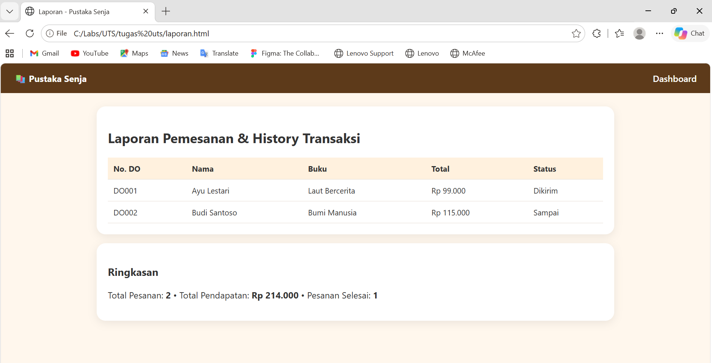

# 📚 Pustaka Senja — Toko Buku Online

> **"Tempat buku menemukan rumahnya."**
> Aplikasi web pemesanan buku sederhana, cozy, dan interaktif.
> Dibuat untuk UTS Pemrograman Web 1.

## 📁 Struktur
pustaka-senja/
├── README.md
├── index.html
├── dashboard.html
├── stok.html
├── checkout.html
├── tracking.html
├── laporan.html
├── css/style.css
└── js/data.js
└── js/script.js

## 🚀 Cara Menjalankan
1. Extract folder `pustaka-senja`
2. Klik 2x `index.html`
3. Login pake `admin@buku.id` / `12345`
4. Selesai! Tidak butuh XAMPP / database.

## 🔑 Akun Demo
- **Email:** `admin@buku.id`
- **Password:** `12345`

## 🧪 Urutan Ngetes
`Login -> Dashboard -> Katalog -> Keranjang -> Checkout -> Tracking -> Laporan`
1. **Login:** Coba login salah -> muncul alert. Login benar -> pindah dashboard.

2. **Dashboard:** Lihat greeting by jam, Hero Promo, Best Seller, Testimoni. Klik 🌙 untuk Dark Mode.

3. **Katalog:** Ketik `Laut` di search, klik filter Novel/Self-Development/Sejarah, klik buku -> Modal Detail.

4. **Keranjang:** Klik `+ Keranjang` -> Toast muncul + badge nambah.

5. **Checkout:** Total otomatis kehitung, bisa hapus item, klik Bayar -> dapat `DO001`.

6. **Tracking:** Ketik `DO001` / `DO002` -> Progress Bar jalan. Ketik `DO999` -> tidak ditemukan.

7. **Laporan:** Lihat tabel history + total pendapatan.

👨‍💻 Dibuat Oleh
Nama: [Aulia Firdha Norfadilla]
NIM: [312510186]
Kelas: [I253A]
Mata Kuliah: Pemrograman Web - UTS

